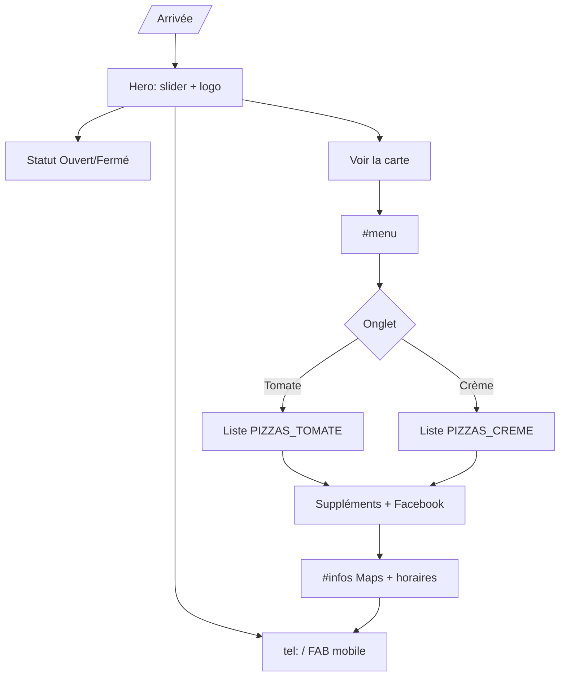
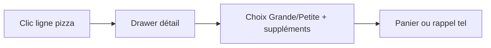

# App Flow — Mia Pizza

## 1. Parcours principal (v1.0 — As-built)

## 2. Parcours v2 (Backlog — non implémenté)

**Décision produit :** drawer réservé au backlog v2.

## 3. Sections (ancres)

| Section | ID | Action clé |
|---------|-----|------------|
| Hero | — | Statut, `#menu`, tel |
| Carte | `#menu` | Onglets tomate/crème |
| Infos | `#infos` | Maps, copier tel |

## 4. États — ouverture

- **Ouvert** : dans un créneau `WEEK_SLOTS` (`data/hours.ts`)  
- **Fermé** : « Ouvre à … » ou « Hors horaires d'ouverture »  
- Refresh client toutes les 60 s ; hydratation via flag `mounted`
