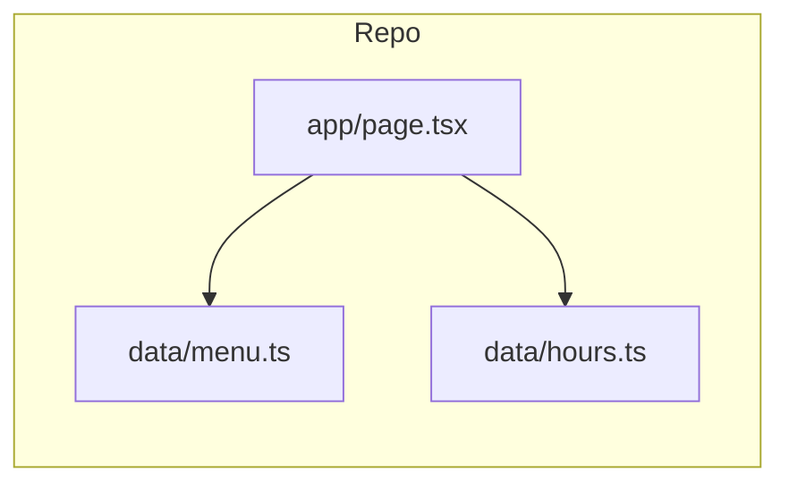

# Schéma données & backend — Mia Pizza

## 1. Architecture v1 (As-built)

**Pas de serveur applicatif ni base SQL.**

### Modèle logique (TypeScript)

- **`PizzaItem`** : `name`, `ingredients`, `grande`, `petite | null`  
- **`WEEK_SLOTS`** : `Record<dayOfWeek 0–6, { start, end }[]>` (minutes depuis minuit)  
- Constantes contact dans `app/page.tsx` (tel, adresse, Maps, Facebook)

**Mise à jour carte :** éditer `data/menu.ts` → commit → redeploy Vercel.

## 2. Architecture v2 (Backlog — Supabase)

Non planifiée sur 12 mois. Référence si admin en ligne requis.

### Tables proposées

- `categories` (tomate, crème, …)  
- `products` (prix small/large, ingredients[], is_featured)  
- `store_settings` (phone, address, fermeture temporaire)  
- `opening_hours` (créneaux récurrents)  
- `closure_exceptions` (congés)

### API minimale

- `GET /api/menu`  
- `GET /api/status`

## 3. Congés sans DB (v1.x)

Variables d’environnement optionnelles :

- `NEXT_PUBLIC_FORCE_CLOSED`  
- `NEXT_PUBLIC_CLOSURE_MESSAGE`
